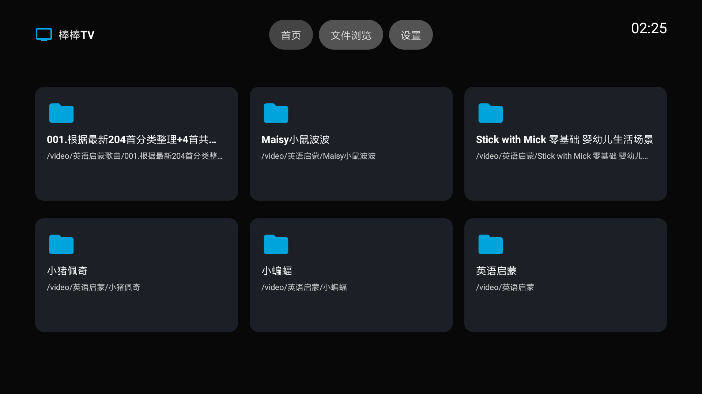
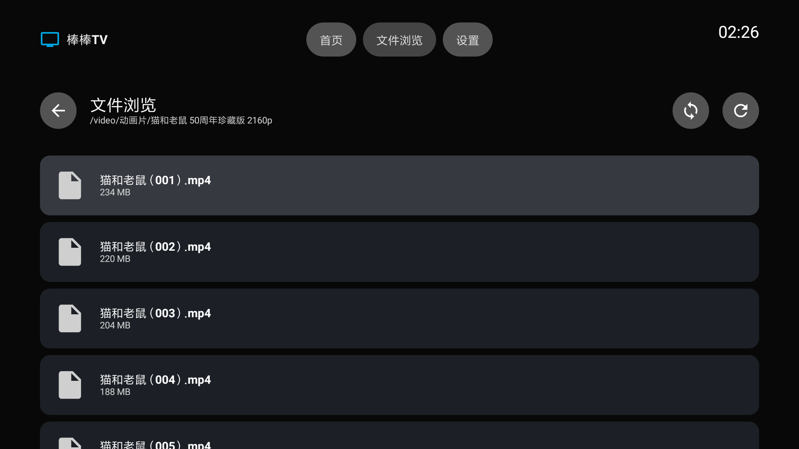
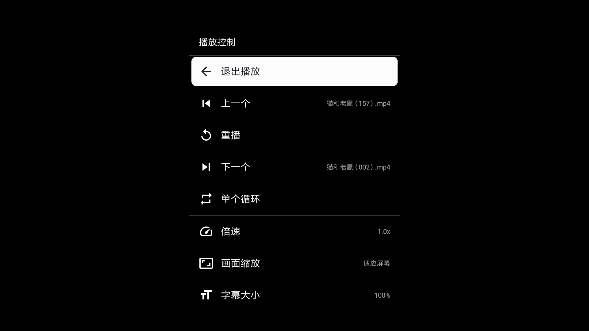
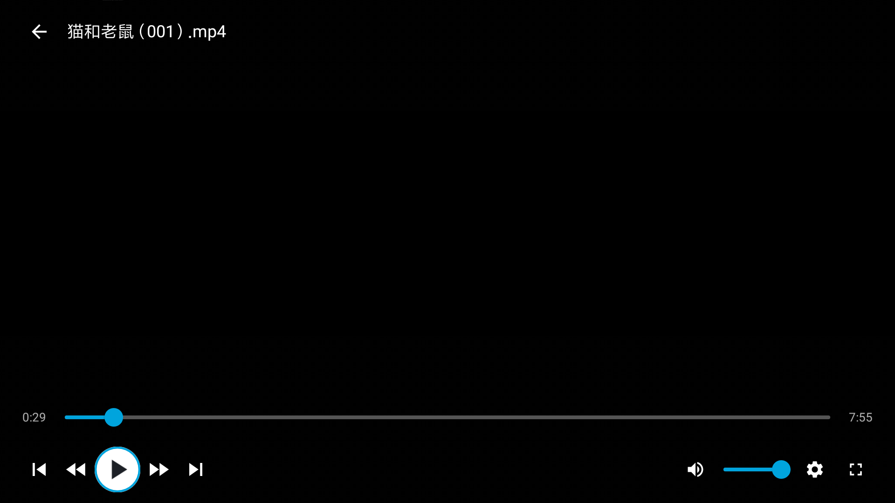
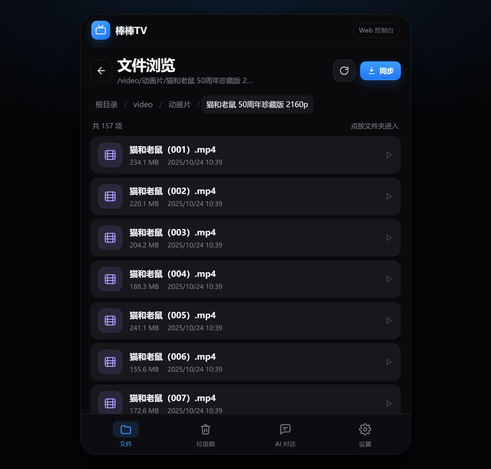
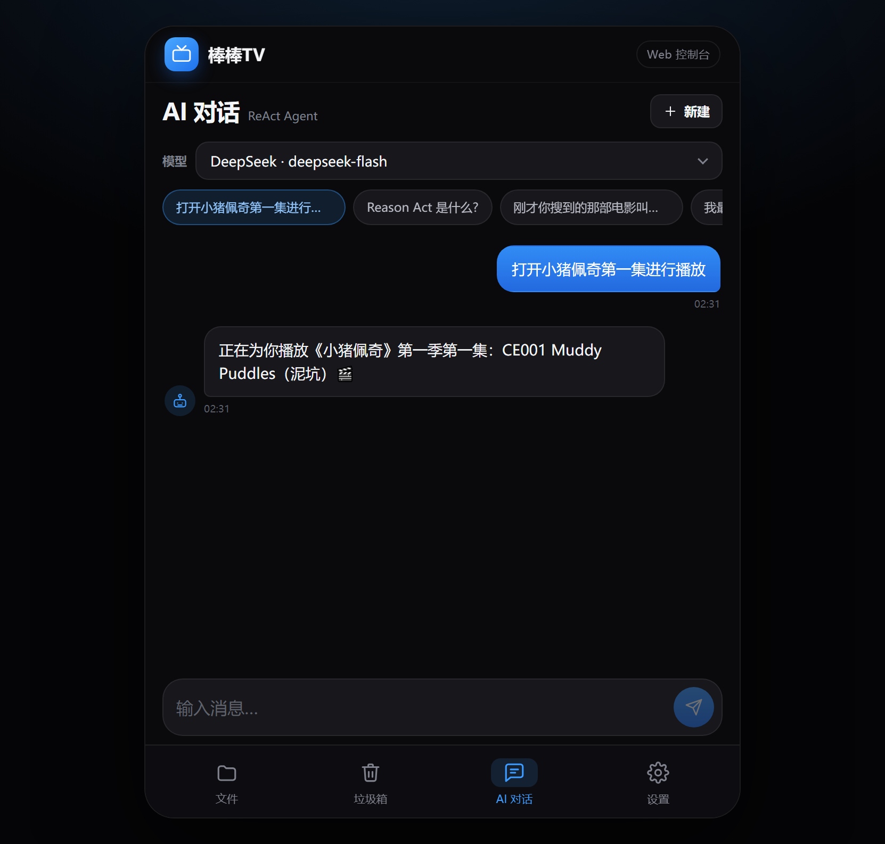
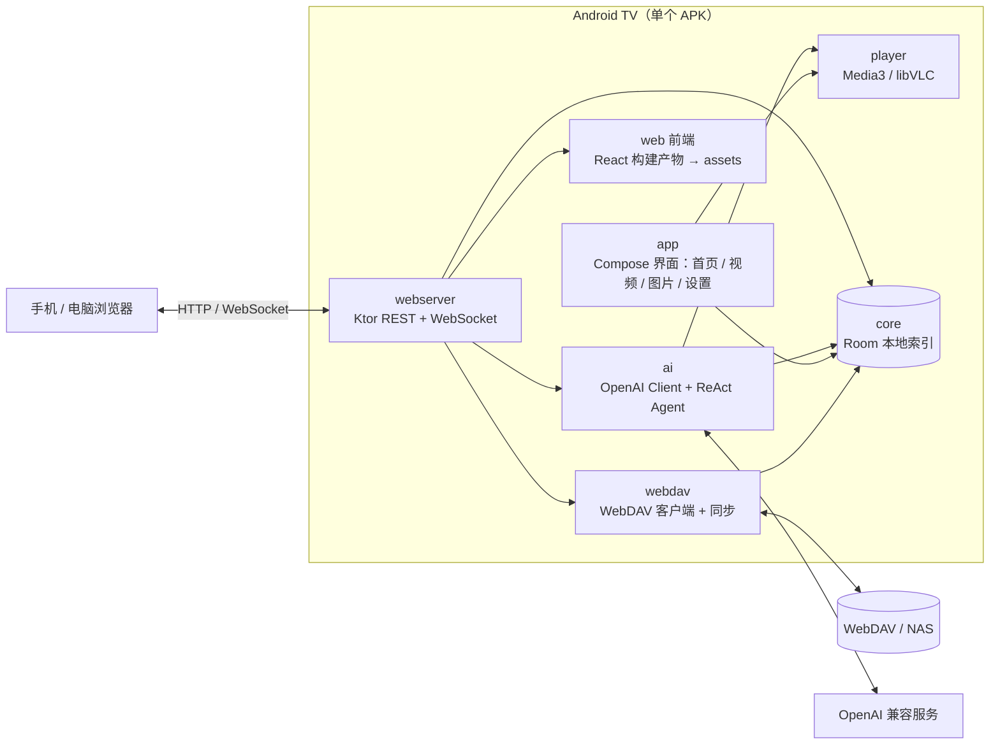

# 棒棒TV

<div>
  
  
  
  
</div>

<br>

运行在 Android TV 上的 WebDAV 媒体库播放器，带一个内嵌的 Web 控制台和能替你操作电视的 AI Agent。

拿起遥控器，浏览 NAS 上的影片；或者打开手机网页，对 AI 说一句 **「打开小猪佩奇第一集进行播放」**——它会自己搜索文件、选中那一集，并在电视上开始播放。

- **一个 APK 搞定全部**：后端服务与 Web 前端全部内嵌在应用里，不需要另外部署服务器。
- **AI 真的能动手**：基于 ReAct 循环的工具调用 Agent，模型可以直接触发播放、搜索、整理媒体库。
- **专为老电视写**：最低支持 Android 6.0（API 23），在 1.6 GB 内存的 32 位小米电视上日常可用。

| 项目 | 值 |
| --- | --- |
| 应用名 | 棒棒TV |
| 包名 | `com.tvplayer.app` |
| 当前版本 | 1.1.0（versionCode 2） |
| 最低系统 | Android 6.0（API 23） |

## 界面

### 电视端

<table>
  <tr>
    <td align="center">
      <br>
      <sub>首页：收藏文件夹宫格，方向键即可走完全部操作</sub>
    </td>
    <td align="center">
      <br>
      <sub>文件浏览：本地索引直出目录与文件大小，不卡网络</sub>
    </td>
  </tr>
  <tr>
    <td align="center">
      <br>
      <sub>菜单键唤出播放控制：上下集、倍速、画面缩放、字幕大小</sub>
    </td>
    <td align="center">
      <br>
      <sub>遥控器聚焦到底部操作按钮时的高亮态</sub>
    </td>
  </tr>
</table>

> 播放器截图里画面是黑的：ExoPlayer 走 SurfaceView，不参与系统截图（libVLC 用 TextureView 可以截到），控制栏与进度都正常。

### Web 控制台

<table>
  <tr>
    <td align="center">
      <br>
      <sub>文件浏览：面包屑 + 同步进度，手机上是移动端布局</sub>
    </td>
    <td align="center">
      <br>
      <sub>AI 对话：一句话让电视开始播放，可切换 Provider 与模型</sub>
    </td>
  </tr>
</table>

## 功能

### 媒体库

- 连接 WebDAV（群晖、Alist、坚果云等），支持保存多套来源并随时切换当前媒体库。
- 全量同步目录树到本地 Room 索引并带有效期检查，同步进度通过 WebSocket 实时推到网页。
- 文件浏览与首页收藏文件夹；播放进度自动记录，从首页可继续上次看到的位置。
- 电视端负责浏览与播放，垃圾箱（软删除、可恢复）在 Web 控制台管理，AI 也能直接执行删除。
- 本地索引让目录浏览、搜索和 AI 检索都不必每次回源远端，NAS 抖动不影响操作手感。

### 播放

- 双引擎：Media3 / ExoPlayer 优先，遇到不支持的容器或编码时带进度自动回退 libVLC，兼容 RMVB、AVI、WMV 等老片源。
- 外挂字幕自动匹配同名字幕文件，播放中可切换字幕与字号。
- 进度条、音量、上/下一集、单个循环、倍速、画面缩放，全部遥控器可完成。
- 电视端顶部 Tab 为 首页 / 视频 / 图片 / 设置，图片支持宫格浏览、按名称/时间/目录排序与全屏预览。

### AI 控制电视

- 接入任意 OpenAI 兼容服务（DeepSeek、OpenAI、本地模型等），Provider 与模型在 Web 控制台配置。
- ReAct（Reason + Act）循环，最多 10 轮工具调用，工具执行结果回传模型继续推理。
- 当前向模型暴露 5 个工具：

| 工具 | 作用 |
| --- | --- |
| `search_files` | 按关键词、类型（视频/音频）和目录范围搜索媒体库 |
| `list_directory` | 列出指定目录下的文件和子目录 |
| `get_play_history` | 获取最近播放记录 |
| `play_file` | 校验文件并在电视上启动播放 |
| `delete_to_trash` | 将文件软删除到垃圾箱，可恢复 |

典型链路：

```
网页输入「打开小猪佩奇第一集进行播放」
  → 模型调用 search_files 命中候选
  → 模型调用 play_file
  → 工具解析路径并拉起 VideoPlayerActivity
  → 电视开始播放，网页收到回复
```

### Web 控制台

- 后端与前端资源全部内嵌在 APK 中，随 App 进程启动，无需单独部署。
- 电视设置页展示二维码，扫码即可在手机或电脑打开 `http://<电视IP>:8080`。
- 包含文件浏览、垃圾箱、AI 对话、WebDAV 来源与 AI Provider 设置。
- 移动端优先设计，手机、平板、桌面浏览器都可用；还提供 `/input/:token` 页面，用手机代替遥控器输入。

## 架构



### 模块职责

| 模块 | 职责 | 关键技术 |
| --- | --- | --- |
| `app` | TV 端 Compose 界面、播放页、设置页、应用入口 | Compose Material3、Hilt |
| `core` | Room 数据库、DAO、Repository、领域模型与排序工具 | Room、Coroutines Flow |
| `webdav` | WebDAV 目录读取、文件操作、全量同步入库 | OkHttp、DOM 解析 |
| `player` | 双引擎播放服务、进度/音轨/字幕状态、字幕查找 | Media3 ExoPlayer、libVLC |
| `ai` | OpenAI 兼容客户端、ReAct 循环、工具执行 | OkHttp、org.json |
| `webserver` | REST API、WebSocket 事件、内嵌 Web 静态资源 | Ktor + Netty |
| `web` | Web 控制台源码 | React、TypeScript、Vite |

### 关键设计

- **内嵌后端**：Ktor 随 App 进程启动，Web 前端作为 assets 打进 APK。用户只装一个应用，同一局域网内的手机/电脑扫码就有控制台。
- **本地索引优先**：WebDAV 目录遍历慢且不稳定，同步服务把文件树落到 Room。文件浏览、搜索和 AI 工具全部查本地索引；同步按目录逐层提交，单个目录失败不会丢掉已入库的数据。
- **AI 与播放器解耦**：`play_file` 只负责解析路径并通过 Intent 拉起 `VideoPlayerActivity`，播放能力仍由 `player` 模块提供。Agent 不碰播放器内部状态，替换播放实现不影响 AI 链路。
- **双引擎兜底**：Android TV 硬件解码能力差异极大，ExoPlayer 失败时同一次播放带进度切到 libVLC，照顾老片源和老设备。
- **遥控器优先交互**：所有操作可用方向键完成；顶部 Tab 获得焦点即切换，菜单键打开上下文菜单，不做长按手势、不做会吞焦点的容器。
- **老设备兼容**：`minSdk 23` 适配 Android 6 电视；Release 仅打包 `armeabi-v7a`，去掉 arm64 版 libVLC 后安装包从约 111 MB 降到约 60 MB。

## 技术栈

| 层 | 组件 |
| --- | --- |
| Android | Kotlin 1.9.22、Jetpack Compose Material3、Hilt 2.50、Room 2.6、Coroutines / Flow |
| 播放 | Media3 / ExoPlayer 1.3、libVLC 3.6 |
| 网络与后端 | OkHttp 4.12、Ktor 2.3（Netty、WebSocket、CORS） |
| AI | OpenAI Chat Completions 协议、ReAct Agent、工具调用 |
| Web | React 18、TypeScript 5、Vite 5、React Router 6、Zustand、Axios |
| 构建 | Gradle 8.5（wrapper）、AGP 8.2、JDK 17、minSdk 23 / targetSdk 34 |

## 快速开始

### 环境

- JDK 17+（AGP 8.2 要求至少 17）
- Android SDK 34
- Node.js 18+（仅修改 Web 前端时需要）

克隆后先写一份本机 `local.properties`（该文件不入库）：

```properties
sdk.dir=<你的 Android SDK 路径>
```

### 构建 APK

仓库里带了一份已构建好的前端产物（`app/src/main/assets/web/`），只改 Kotlin 代码时直接 `./gradlew assembleDebug` 即可，不必装 Node。

Windows 一键构建前端并打包 Release：

```bat
build-all.bat
```

分步构建：

```bash
cd web
npm install
npm run build
# 产物 web/dist 的内容需要落到 app/src/main/assets/web/，build-all.bat 会自动完成这一步

./gradlew assembleDebug    # 本机调试
./gradlew assembleRelease  # 需要配置签名，见下
```

### 配置 Release 签名

签名信息只从本机读取，仓库里不含任何口令。在项目根目录的 `local.properties` 里追加（也可写在 `~/.gradle/gradle.properties` 或用 `-P` 参数）：

```properties
RELEASE_STORE_FILE=app/release-keystore.jks
RELEASE_STORE_PASSWORD=<口令>
RELEASE_KEY_ALIAS=<别名>
RELEASE_KEY_PASSWORD=<口令>
```

未配置这四项时，`assembleRelease` 会回落到 debug 签名，产物依然可以安装，方便快速验证；正式分发请换成自己的 keystore。`*.jks` 已在 `.gitignore` 中，不会被提交。

生成一个自用 keystore：

```bash
keytool -genkeypair -v -keystore app/release-keystore.jks \
  -alias tvplayer -keyalg RSA -keysize 2048 -validity 10000
```

### 安装到电视

```bash
adb connect <电视IP>:5555
adb install -r app/build/outputs/apk/release/app-release.apk
```

首次打开需在「设置」里添加 WebDAV 来源，等待同步完成后即可浏览和播放。

### 使用 Web 控制台

保持电视端 App 运行，在同一局域网访问：

```
http://<电视IP>:8080
```

电视「设置」页右侧有二维码，可直接扫码打开。若 8080 被占用，服务会自动顺延到下一个可用端口，实际地址以设置页二维码为准。

### 前端开发模式

```bash
# 把电视的 8080 端口转发到本机，Vite 代理会访问 localhost:8080
adb forward tcp:8080 tcp:8080

cd web
npm install
npm run dev   # http://localhost:3000
```

## 目录结构

```
TV-player/
├── app/          # TV 端界面、Activity、应用入口、内嵌 Web 静态资源
├── core/         # Room 实体 / DAO / Repository / 领域模型 / 排序工具
├── webdav/       # WebDAV 客户端与全量同步服务
├── player/       # ExoPlayer + libVLC 播放服务、字幕查找
├── ai/           # OpenAI 客户端、ReAct Agent、工具执行
├── webserver/    # Ktor REST / WebSocket / 静态资源
├── web/          # React Web 控制台源码
├── docs/         # 运行截图
└── build-all.bat # 前端构建 + 资源打包 + Release 构建
```

## 开发说明

- 单元测试：`./gradlew :core:testDebugUnitTest`，覆盖文件名智能排序（阿拉伯数字、中文数字混排）与图片排序模式。
- 老设备兼容：`minSdk 23` 靠核心库脱糖（`desugar_jdk_libs`）补齐 `java.time` 等 API 26+ 类，业务代码不用改；Ktor 的 Netty 引擎在 API 23 真机上实测可正常监听，不必换成 CIO。
- 排序规则：`SmartFileNameComparator` 让 `01.mp4 / 2.mp4 / 第十集 / 第十一集` 按数值而非字典序排列，文件浏览、图片宫格和 AI 搜索结果共用这套规则。
- 工具声明与执行分离：`ChatService` 决定模型能看到哪些工具，`ToolExecutor` 负责落地。执行器里另有 `get_file_info`、`rename_file`、`move_file`、`restore_from_trash` 四个实现尚未在工具声明中暴露，想扩展 AI 能力从这两处入手。
- 代码注释与界面文案使用中文，函数名保持英文风格。

## 常见问题

**电视上装了但桌面图标/名称没变？**
小米电视桌面 `com.mitv.tvhome` 会缓存已安装应用的图标和名称，换图标或改名后执行 `adb shell am force-stop com.mitv.tvhome`，再按 HOME 键让桌面重新加载即可。

**WebDAV 连不上？**
先在同一网络用电脑 `curl` 一次确认地址与端口；注意部分 Alist 配置只放行特定路径前缀，应用侧看到的根目录可能与浏览器不同。

**截图里播放画面是黑的？**
ExoPlayer 的 SurfaceView 不参与系统截图，libVLC（TextureView）可以截到；判断播放是否正常请看进度与时间，不要看截图。

**支持 arm64 电视吗？**
当前 Release 只打包 `armeabi-v7a`（向下兼容 arm64 设备的 32 位模式）。需要纯 64 位包时，在 `app/build.gradle.kts` 的 `abiFilters` 中加入 `arm64-v8a` 并放入对应 libVLC 产物，安装包体积会明显增大。

## License

[MIT](LICENSE)
